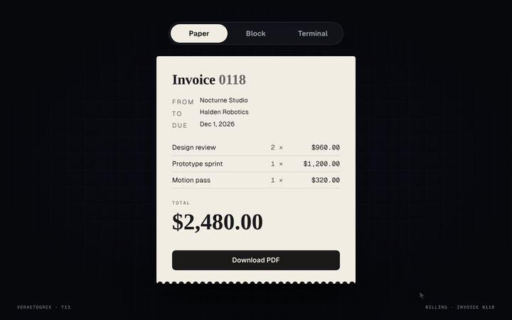

# Invoice Styles

**One invoice. Three looks.**



**Live demo:** [veraetogrex-portfolio.github.io/invoice-styles](https://veraetogrex-portfolio.github.io/invoice-styles/) · **Mockup:** [full-screen version](https://veraetogrex-portfolio.github.io/invoice-styles/mockup/invoice-styles.html)

Paper, Block, Terminal. Switching style doesn't just recolour it: every block flies to its new place (FLIP), the terminal types itself out, and the total rolls like an odometer.

## Use it

Three files, no build step, no dependencies, no web fonts:

```
index.html   markup
style.css    styles and keyframes
script.js    behaviour
```

Download the repo and open `index.html`, or copy the three files into your project.

## Try it

- Switch **Paper / Block / Terminal**.
- In Block, `+` and `−` change the quantity and the total rolls to the new sum.

## Make it yours

Line items are plain markup with `data-price`; quantities and the total are computed in `script.js`. Each style is one class on `#invoice` (`is-paper`, `is-block`, `is-term`) with its own layout block in `style.css` — add a fourth the same way.

## What's in `mockup/`

The full 1440×900 screen this component was shot in for the reel:

- `mockup/invoice-styles.html` — interactive. `D` plays the demo, `R` resets.
- `mockup/invoice-styles.autoplay.html` — the scripted loop the reel was recorded from.
- URL flags: `?frame` puts the screen in a browser window, `?clean` hides the control panel, `?once` plays the demo once.

The mockup loads the same `style.css` and `script.js` from the root, plus a shared stage runtime and bundled fonts from `mockup/_shared/`. The component in the root doesn't need any of it.

---

Component 13 of a series. New one every day on Instagram [@veraetogrex_portfolio](https://www.instagram.com/veraetogrex_portfolio/) · all components: [github.com/veraetogrex-portfolio](https://github.com/veraetogrex-portfolio)

MIT licensed.
